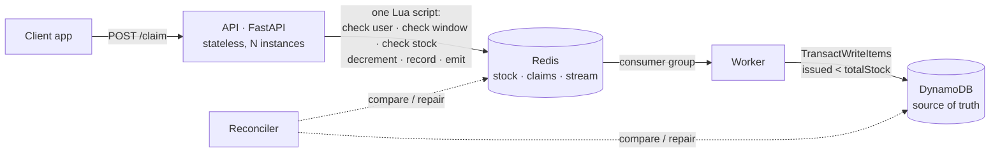

# Flash-Sale Voucher Engine

A voucher service built for flash sales: **50,000 users try to claim 1,000 vouchers in ~10
seconds**, with no over-redemption, no double claims, and every issued voucher durably
persisted.

Design rationale and trade-offs: [docs/PLAN.md](docs/PLAN.md) · API spec:
[docs/openapi.yaml](docs/openapi.yaml) · Postman: [docs/postman/](docs/postman/)

---

## Contents

1. [How it works](#1-how-it-works)
2. [Quick start (local Docker)](#2-quick-start-local-docker)
3. [Using the API](#3-using-the-api)
4. [Authentication](#4-authentication)
5. [Testing](#5-testing)
6. [Operations](#6-operations)
7. [Configuration](#7-configuration)
8. [Deploying to AWS](#8-deploying-to-aws)
9. [Troubleshooting](#9-troubleshooting)
10. [Project layout & make targets](#10-project-layout--make-targets)

---

## 1. How it works



**Fast path:** a claim is a single atomic Lua script in Redis: it checks the user, the
campaign window and the stock, then decrements the stock, records the claim and emits an
event, all with nothing else running in between. That's one network round trip, with no
locks and no race window.

**Durable path:** a worker reads the claim events from a Redis stream and writes them to
DynamoDB. Each write is a transaction that also increments the campaign's `issued`
counter, but only while `issued < totalStock`.

| Guarantee | Enforced by |
|---|---|
| At most one voucher per user per campaign; retries return the same code | Lua script + Redis `claims` hash |
| Exactly `totalStock` `WON` responses (while Redis is healthy) | Lua script |
| DynamoDB **never** holds more than `totalStock` issued vouchers, even after a Redis failover | Worker transaction (`issued < totalStock`) |
| A worker crash loses no claims | Stream consumer group + `XAUTOCLAIM`, idempotent writes |
| Redis ↔ DynamoDB drift is detected and repaired | Reconciler |

**Voucher lifecycle:**

```
claim ──► PENDING ──(worker, ~ms)──► ISSUED ──(redeem)──► REDEEMED
                               └──► REVOKED   (durable cap refused it; only after a Redis failover)
```

---

## 2. Quick start (local Docker)

**Prerequisites:** Docker with Compose v2 (your user in the `docker` group) and Python 3.12.

```bash
make venv                 # .venv with dev + load-test dependencies
cp .env.example .env      # REQUIRED: points host-side tools at local Redis/DynamoDB
make up                   # builds the image; starts redis, dynamodb-local, init, api, worker
make smoke                # ~2 s end-to-end check of every endpoint
```

What's running:

| Service | Port (host) | Role |
|---|---|---|
| `api` | `8000` | FastAPI (4 uvicorn workers). Swagger UI at http://localhost:8000/docs |
| `worker` | — | Stream consumer → DynamoDB |
| `redis` | `6379` | Redis 7.4 with AOF |
| `dynamodb` | `8001` | DynamoDB Local (in-memory — **data is lost on restart**) |
| `init` | — | One-shot: creates the DynamoDB tables, then exits |
| `reconciler` | — | On demand (`make reconcile`); compose profile `tools` |

After changing code, rebuild with `make up` (it runs `--build`). Stop and wipe everything
with `make down`.

> `.env` matters: without it, host-side scripts (load tests, smoke test, reconciler run
> from the host) would try **real AWS** DynamoDB instead of DynamoDB Local.

---

## 3. Using the API

Interactive docs: **http://localhost:8000/docs** (Swagger) or **/redoc**. The same spec is
committed as [`docs/openapi.json`](docs/openapi.json) / [`docs/openapi.yaml`](docs/openapi.yaml).

### Endpoints

| Method | Path | Who | Purpose |
|---|---|---|---|
| `GET` | `/health` | anyone | Health check: API up and Redis reachable (200 / 503) |
| `POST` | `/campaigns` | admin | Create a campaign and seed its stock |
| `POST` | `/campaigns/{campaignId}/claim` | user | Claim a voucher |
| `GET` | `/campaigns/{campaignId}/my-voucher` | user | Get your voucher in a campaign |
| `POST` | `/vouchers/{code}/redeem` | owner | Redeem your voucher at checkout |

All errors use FastAPI's shape: `{"detail": "<message>"}` (422 validation errors carry a
list in `detail`).

### Health check

```bash
curl -s localhost:8000/health
# 200 {"ok":true}
```

| HTTP | Body | Meaning |
|---|---|---|
| 200 | `{"ok":true}` | API is up and Redis is reachable |
| 503 | `{"detail":"redis unreachable"}` | API is up but can't serve claims |

- **No auth needed.** Both the ALB target group and the docker-compose healthcheck use it.
- **DynamoDB isn't checked, on purpose.** Claims only need Redis. If DynamoDB is degraded,
  the worker retries and the API stays in rotation.

### Walkthrough with curl

```bash
ADMIN=$(.venv/bin/python -m common.devtokens ops-admin --admin)
ALICE=$(.venv/bin/python -m common.devtokens alice)
BOB=$(.venv/bin/python -m common.devtokens bob)
```

**Create a campaign** (admin):

```bash
curl -s -X POST localhost:8000/campaigns \
  -H "Authorization: Bearer $ADMIN" -H 'Content-Type: application/json' \
  -d '{"campaignId":"sale-1111","totalStock":1,
       "startAt":"'"$(date -u +%FT%TZ)"'","endAt":"'"$(date -u -d '+1 hour' +%FT%TZ)"'"}'
# 201 {"campaignId":"sale-1111","totalStock":1,...,"remainingStock":1}
```

- `campaignId`: lowercase letters, digits and `-`, 1–40 chars.
- Times must include a timezone. The window is `[startAt, endAt)`.
- Re-POSTing **identical** parameters returns `200` and is safe: it never refills stock.
  Different parameters for an existing id return `409`.
- Shortcut: `.venv/bin/python -m loadtest.create_campaign sale-1111 --stock 1000`.

**Claim**:

```bash
curl -s -X POST localhost:8000/campaigns/sale-1111/claim -H "Authorization: Bearer $ALICE"
# {"result":"WON","voucherCode":"sale-1111.K7QZ3MWD9P"}
curl -s -X POST localhost:8000/campaigns/sale-1111/claim -H "Authorization: Bearer $ALICE"
# {"result":"ALREADY","voucherCode":"sale-1111.K7QZ3MWD9P"}     ← same code, no new voucher
curl -s -X POST localhost:8000/campaigns/sale-1111/claim -H "Authorization: Bearer $BOB"
# {"result":"SOLD_OUT","voucherCode":null}
```

| HTTP | `result` / `detail` | Meaning | What the client should do |
|---|---|---|---|
| 200 | `WON` | You got a voucher | Show the code |
| 200 | `ALREADY` | You claimed before (double tap / retry) | Show the returned code, which is the original one |
| 200 | `SOLD_OUT` | No stock left | Show "sold out"; **don't retry** |
| 200 | `REVOKED` | Your earlier win was refused by the durable cap (rare, post-failover) | Apologise; no voucher |
| 409 | `NOT_STARTED` / `ENDED` | Outside the window | Show a countdown / "ended" |
| 429 | `slow down` | Per-user rate limit (default 5 req/s) | Back off and retry |
| 404 | `unknown campaign` | No such campaign | — |

Claims are **idempotent**. A client that times out can retry the same request without
risking a second voucher.

**Check my voucher**:

```bash
curl -s localhost:8000/campaigns/sale-1111/my-voucher -H "Authorization: Bearer $ALICE"
# {"campaignId":"sale-1111","voucherCode":"sale-1111.K7QZ3MWD9P","status":"ISSUED",
#  "claimedAt":1780747203277,"redeemedAt":null}
```

`status` is `PENDING` for the few milliseconds before the worker persists the claim, then
`ISSUED`, `REDEEMED` or `REVOKED`. If you have no voucher in the campaign, the response is `404`.

**Redeem** (only the owner can redeem a code):

```bash
curl -s -X POST localhost:8000/vouchers/sale-1111.K7QZ3MWD9P/redeem -H "Authorization: Bearer $ALICE"
# 200 {"status":"REDEEMED","redeemedAt":1780747450000,...}
```

| HTTP | Meaning |
|---|---|
| 200 | Redeemed |
| 409 `voucher is REDEEMED` / `REVOKED` | Can't redeem twice / revoked |
| 409 `still being issued` + `Retry-After: 1` | Still `PENDING`; retry in a second |
| 404 | Malformed code, unknown code, or **not your voucher** |

### Postman

Import both files from [`docs/postman/`](docs/postman/):

- `flash-voucher.postman_collection.json`
- `local.postman_environment.json` (select it as the active environment)

How the collection works:

- **No token copy-pasting:** in `authMode=dev`, a collection-level pre-request script signs
  dev JWTs with `devJwtSecret`.
- **Run it top to bottom:** use the Collection Runner on *1. Happy path*. Each run creates a
  fresh campaign, then runs claim → duplicate claim → my-voucher → redeem → redeem again,
  with assertions on every step. *2. Negative cases* covers 401, 403, 404 and 422.
- **Act as someone else:** change the `userId` collection variable.
- **Against Cognito:** set `authMode=cognito` and paste access tokens into `userToken`,
  `otherUserToken` and `adminToken`.

### Integrating a client app

1. On "Claim" tap, call `POST /claim` with an idempotent retry on network errors or 5xx.
   Disable the button while the request is in flight; double taps are harmless anyway.
2. Branch on `result`, as in the table above. Sold out is a normal 200 outcome, not an error.
3. Show the voucher from `voucherCode` right away. You don't have to wait for `ISSUED`.
4. At checkout, call `POST /vouchers/{code}/redeem`. On `409` with `Retry-After`, retry once.

---

## 4. Authentication

Every endpoint except `/health` requires `Authorization: Bearer <JWT>`. The caller's user
id is the token's `sub`. Admin endpoints require `admin` (configurable with `ADMIN_GROUP`)
in the `cognito:groups` claim.

| `AUTH_MODE` | Tokens | Use |
|---|---|---|
| `dev` (default) | HS256, signed with `DEV_JWT_SECRET` | Local, tests, load tests |
| `cognito` | RS256 Cognito **access** tokens; issuer, `token_use=access` and `client_id` are checked; JWKS cached | AWS |

Mint dev tokens:

```bash
.venv/bin/python -m common.devtokens alice            # user token (1 h)
.venv/bin/python -m common.devtokens ops --admin      # admin token
```

Never expose an `AUTH_MODE=dev` deployment publicly: anyone with the secret can mint
tokens for any user.

---

## 5. Testing

| What | Command | Needs | Time |
|---|---|---|---|
| Unit/integration tests | `make test` | nothing (fakeredis + moto) | ~5 s |
| Smoke test | `make smoke` | running stack | ~2 s |
| Correctness load test | `make loadtest USERS=50000 STOCK=1000` | running stack | ~1 min |
| Latency load test | `make locust CAMPAIGN=sale1` | running stack | as long as you like |
| Chaos: worker crash | `make chaos-worker` | running stack | ~30 s |
| Chaos: Redis data loss | `make chaos-redis CAMPAIGN=<sold-out id>` | running stack | seconds |
| Lint | `make lint` | — | — |

### Unit/integration tests: `make test`

These run in-process against fakeredis (executing the real Lua scripts) and moto (mocked
DynamoDB). They cover:
- exactly-N winners under concurrent load, duplicate taps, and window/sold-out edge cases;
- the worker: idempotency, the transactional cap and `REVOKED`, crash recovery, and dead-lettering;
- reconciler repairs and the full API lifecycle;
- that `docs/openapi.*` and the Postman collection are still in sync with the code.

### Smoke test: `make smoke`

The smoke test calls every endpoint once on a fresh 2-voucher campaign. It also waits for
the worker to persist the claim, so it exercises the whole pipeline. Use it after every
`make up` or deploy.

```bash
make smoke                                                 # local, dev tokens
.venv/bin/python -m scripts.smoke --base-url http://<alb> \
  --admin-token "$ADMIN" --user-tokens "$U1,$U2,$U3"       # AWS / Cognito: 3 distinct users
```

It first waits up to 30 s (`--wait-ready`) for `/health` to return 200, so it's safe to run
right after `make up`. It prints a ✓/✗ checklist and exits `1` on any failure, so it can be used in CI or deploy
scripts.

### Correctness load test: `make loadtest`

This test creates a campaign, then fires one claim per user plus 5% duplicate taps. It
waits for the worker to finish and then asserts:
- exactly `STOCK` `WON` responses and no 5xx;
- every code is unique and no user saw two codes;
- DynamoDB `ISSUED` rows == `Campaigns.issued` == Redis claims == `STOCK`.

```bash
.venv/bin/python -m loadtest.correctness --users 50000 --stock 1000 --concurrency 100
```

Sample output (4-core laptop, client and server sharing the CPUs):

```
5250 requests in 5.06s (1038 req/s)
outcomes: {'WON': 1000, 'ALREADY': 94, 'SOLD_OUT': 4156}
latency ms: p50=44.4 p95=343.4 p99=425.8      # at --concurrency 20: p50=11 p99=77
DynamoDB ISSUED rows=1000 counter=1000 | Redis claims=1000
PASS  all assertions held
```

Locally, the client and server compete for the same CPUs, so higher `--concurrency` mostly
measures that contention. Use AWS for the headline numbers.

### Latency load test (Locust)

```bash
make locust CAMPAIGN=sale1 STOCK=1000          # web UI at http://localhost:8089
# headless, 50k users, distributed (one worker per core):
CAMPAIGN_ID=sale1 .venv/bin/locust -f loadtest/locustfile.py --master --headless \
  --host http://localhost:8000 -u 50000 -r 5000 -t 60s
CAMPAIGN_ID=sale1 .venv/bin/locust -f loadtest/locustfile.py --worker   # ×N
```

### Chaos

- **`make chaos-worker`:** sends `SIGKILL` to the worker mid-sale, keeps it down for 10 s,
  restarts it, then asserts that every claim was persisted. Pending events are recovered
  through `XAUTOCLAIM` after `WORKER_MIN_IDLE_MS` (5 s locally).
- **`make chaos-redis CAMPAIGN=<id>`:** deletes claims from Redis and gives their stock
  back, which is what a failed-over replica would look like. It then asserts that the
  reconciler detects the gap, restores the claims and drops stock back to 0. Use a
  **sold-out** campaign, for example one created by `make loadtest`.
- **In AWS:** use the FIS experiments in `infra/fis.yaml` (kill the worker tasks; cut power
  to the AZ running the Redis primary).

---

## 6. Operations

### Reconciler

```bash
make reconcile                                            # report only, all active campaigns
docker compose run --rm reconciler python -m reconciler.main --campaign sale-1111 --fix
```

The reconciler prints one JSON report per campaign. It exits `1` if it finds drift and
`--fix` wasn't given.

| Field | Meaning | `--fix` does |
|---|---|---|
| `redis_only` | Claimed in Redis, missing in DynamoDB past the grace period (lost or dead-lettered event) | Re-enqueues the event; the worker is idempotent |
| `dynamo_only` | In DynamoDB, missing in Redis (Redis lost writes) | Restores it to Redis and lowers stock |
| `code_mismatch` | Different codes in each store | Report only; needs a human |
| `counter_mismatch` | `Campaigns.issued` ≠ number of ISSUED + REDEEMED rows | Report only |
| `over_issued` | More than `totalStock` issued in DynamoDB; should be impossible | Report only, plus the `OverIssued` metric |

In AWS it runs every 5 minutes with `--fix`, as a scheduled ECS task.

### Inspecting state

```bash
docker compose exec redis redis-cli
> GET    "{campaign:sale-1111}:stock"            # remaining stock
> HLEN   "{campaign:sale-1111}:claims"           # number of claims
> HGET   "{campaign:sale-1111}:claims" alice     # alice's code
> XINFO  GROUPS "{campaign:sale-1111}:events"    # pending / lag (should drain to 0)
> XRANGE "{campaign:sale-1111}:dlq" - +          # dead-lettered events
```

```bash
docker compose logs -f api worker
AWS_ACCESS_KEY_ID=local AWS_SECRET_ACCESS_KEY=local aws dynamodb scan \
  --endpoint-url http://localhost:8001 --region ap-southeast-1 --table-name VoucherClaims
```

### Dead letters

The worker dead-letters an event when it is malformed or has failed more than
`WORKER_MAX_DELIVERIES` (5) times. The claim itself is still in Redis. After you fix the
cause (for example a DynamoDB outage), run the reconciler with `--fix`. It finds those
claims as `redis_only` and re-enqueues them.

### Metrics

With `METRICS_EMF=true` (the default in AWS), each service writes CloudWatch Embedded
Metric Format lines to stdout, in namespace `FlashVoucher` with dimension `Service`:

| Service | Metrics |
|---|---|
| api | `ClaimLatency` (p50/p99), `ClaimWon`, `ClaimAlready`, `ClaimSoldOut`, `ClaimRateLimited`, `ClaimReplicationLagging` |
| worker | `PersistLatency`, `PersistIssued`, `PersistDuplicate`, `PersistRevoked`, `PersistErrors`, `DeadLettered`, `StreamPending`, `StreamLag` |
| reconciler | `Drift`, `OverIssued` |

`infra/stack.yaml` creates a dashboard from these and sets alarms on `DeadLettered`,
`PersistRevoked` and `Drift`.

---

## 7. Configuration

Every setting is an environment variable (or a line in `.env`). Defaults are in
[`common/settings.py`](common/settings.py).

| Variable | Default | Purpose |
|---|---|---|
| `REDIS_URL` | `redis://localhost:6379/0` | Use `rediss://` for TLS (ElastiCache) |
| `REDIS_WAIT_REPLICAS` | `0` | After a `WON`, wait for this many replica acks; shrinks the failover-loss window |
| `REDIS_WAIT_TIMEOUT_MS` | `20` | Maximum time to wait for those acks |
| `AWS_REGION` | `ap-southeast-1` | |
| `DYNAMODB_ENDPOINT` | — | Set for DynamoDB Local (`http://localhost:8001` from the host) |
| `AWS_ACCESS_KEY_ID` / `AWS_SECRET_ACCESS_KEY` | — | Only for DynamoDB Local; in AWS the task role is used |
| `CAMPAIGNS_TABLE` / `CLAIMS_TABLE` | `Campaigns` / `VoucherClaims` | |
| `AUTH_MODE` | `dev` | `dev` or `cognito` |
| `DEV_JWT_SECRET` | dev placeholder | HS256 secret for dev tokens |
| `COGNITO_REGION` / `COGNITO_USER_POOL_ID` / `COGNITO_CLIENT_ID` | — | Required when `AUTH_MODE=cognito` |
| `ADMIN_GROUP` | `admin` | Group in `cognito:groups` that grants admin |
| `RATE_LIMIT_PER_SEC` | `5` | Claim requests per user per second |
| `WORKER_BATCH_SIZE` | `100` | Events per read |
| `WORKER_BLOCK_MS` | `1000` | How long the worker's read waits for new events |
| `WORKER_MIN_IDLE_MS` | `30000` (compose: `5000`) | How long an event sits unacknowledged before another worker takes it over |
| `WORKER_MAX_DELIVERIES` | `5` | Deliveries before an event is dead-lettered |
| `WORKER_REFRESH_S` | `5` | How often the worker reloads the set of active campaigns |
| `RECONCILER_GRACE_S` | `60` | Ignore claims younger than this (the worker may still be catching up) |
| `METRICS_EMF` | `false` | Emit CloudWatch EMF metrics to stdout |
| `METRICS_NAMESPACE` / `METRICS_FLUSH_S` | `FlashVoucher` / `10` | |

---

## 8. Deploying to AWS

There are three CloudFormation stacks:
- `infra/ecr.yaml`: the image registry;
- `infra/stack.yaml`: DynamoDB, ElastiCache Multi-AZ, ECS Fargate, the load balancer, the
  scheduled reconciler, the dashboard and alarms;
- `infra/fis.yaml`: the chaos experiments.

Step-by-step commands and the pre-deploy checklist are in
[infra/README.md](infra/README.md). After deploying, run:

```bash
.venv/bin/python -m scripts.smoke --base-url "$(aws cloudformation describe-stacks \
  --stack-name flash-voucher --query "Stacks[0].Outputs[?OutputKey=='ApiUrl'].OutputValue" \
  --output text)" --admin-token "$ADMIN" --user-tokens "$U1,$U2,$U3"
```

---

## 9. Troubleshooting

| Symptom | Cause / fix |
|---|---|
| `NoCredentialsError`, or load-test results going to real AWS | `.env` is missing: run `cp .env.example .env` |
| `permission denied ... docker.sock` | `sudo usermod -aG docker $USER`, then log out and back in |
| `make up` fails: port already allocated | Something else is on 8000, 8001 or 6379; stop it or change the ports in `docker-compose.yml` |
| `my-voucher` stays `PENDING` | The worker isn't running: check `docker compose ps worker` and `docker compose logs worker` |
| Smoke test says "ISSUED within 10s" ✗ | Same as above |
| `401 invalid token` | Token expired (1 h), or the secret differs between the minting tool and the API (`DEV_JWT_SECRET`) |
| Many `429`s in your own tests | One user is sending more than `RATE_LIMIT_PER_SEC` requests; use distinct users or raise the limit |
| Load test is slow or shows high latency locally | The client is CPU-bound on the same machine: lower `--concurrency`, or run Locust in distributed mode |
| `Too many open files` during load tests | `ulimit -n 65535` |
| Campaigns gone after a restart | DynamoDB Local runs in-memory, but Redis keeps its data. Run `make down && make up` for a clean slate |
| `/docs` doesn't show new API changes | Rebuild the image with `make up` |
| `make test` fails at `test_openapi_spec_is_up_to_date` | The API changed: run `make openapi postman` and commit the results |

---

## 10. Project layout & make targets

```
api/          FastAPI app (routes, models, OpenAPI metadata), JWT auth
common/       settings, Redis key layout, Lua scripts (lua/), DynamoDB helpers, metrics, dev tokens
worker/       stream consumer (main.py) and the transactional DynamoDB writer (persister.py)
reconciler/   drift check and repair
loadtest/     correctness.py, locustfile.py, create_campaign.py, chaos/
scripts/      smoke.py, export_openapi.py, build_postman.py
docs/         PLAN.md (design), openapi.json/.yaml, postman/
infra/        CloudFormation templates and deploy guide
tests/        pytest suite
```

| Target | Does |
|---|---|
| `make venv` | Create `.venv` with all extras |
| `make up` / `make down` / `make logs` | Start (with rebuild), stop and wipe, follow logs |
| `make test` / `make lint` | pytest / ruff |
| `make smoke` | End-to-end smoke test |
| `make loadtest USERS=… STOCK=…` | Correctness load test |
| `make locust CAMPAIGN=… STOCK=…` | Locust web UI |
| `make chaos-worker` / `make chaos-redis CAMPAIGN=…` | Chaos tests |
| `make reconcile` | Drift report |
| `make openapi` / `make postman` | Regenerate `docs/openapi.*` and `docs/postman/*` |

---

## Results

**Local** (Docker Compose on a 4-core laptop; the load generator shares the CPUs):

| Run | Throughput | p50 | p99 | Outcome |
|---|---|---|---|---|
| 5,000 users + 5% double taps, 1,000 vouchers, 20 in flight | 912 req/s | 11 ms | 77 ms | exactly 1,000 `WON`; DynamoDB = counter = Redis = 1,000 |
| same, 100 in flight | 1,038 req/s | 44 ms | 426 ms | same (latency dominated by client/server CPU contention) |

**AWS:** pending deployment. The 50k-user run, the FIS chaos experiments and the dashboard
screenshots will go here.
