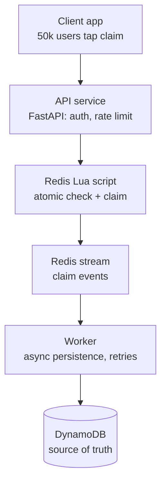

# Flash-Sale Voucher Engine — Plan (v1.1)

> **v1.1 (2026-03-04)** — amended after design review before implementation. Changes are
> summarised in [§11 Amendments](#11-amendments-v11) and marked **(v1.1)** inline.

A pet project simulating a high-traffic flash sale on a super-app: **50,000 users try to claim 1,000 vouchers in ~10 seconds**, with zero over-redemption and no double claims.

---

## 1. Problem & requirements

| Requirement | Target |
|---|---|
| Total vouchers issued | **(v1.1)** DynamoDB (source of truth) never holds more than N issued vouchers — enforced by a transactional cap. Redis targets exactly N `WON` responses; after a Redis failover a few extra `WON`s are possible and are surfaced as `REVOKED` |
| Per-user limit | Max 1 voucher per user per campaign |
| Duplicate taps / client retries | Safe — same result returned, no extra voucher |
| Claim latency | p99 < 100 ms under peak load |
| Durability | Every issued voucher persisted to a source of truth |
| Failure tolerance | Worker crash or restart loses no claims |

**Non-goals (v1):** payments, real merchant integration, UI beyond a simple test client.

---

## 2. Architecture



**Core idea:** separate the *fast path* (claiming, in Redis) from the *durable path* (persisting, in DynamoDB).

- **API service (Python / FastAPI)** — stateless, horizontally scaled. Validates the Cognito JWT, checks the campaign window, applies a per-user rate limit, then calls the Lua script.
- **Redis (ElastiCache)** — holds live stock and the set of users who already claimed. The Lua script does the check-then-act atomically.
- **Redis stream** — the claim event is written *inside the same Lua script*, so claim and event are atomic together.
- **Worker** — consumes the stream (consumer group), writes to DynamoDB with a conditional write, acks the event.
- **DynamoDB** — source of truth for issued vouchers and redemption state.

---

## 3. Key design decision: atomic claim in Lua

### The script

```lua
-- (v1.1) see common/lua/claim.lua for the full commented version
-- KEYS: meta (hash: startAt/endAt/totalStock), stock, claims (hash user->code), events
-- ARGV: user_id, freshly generated voucher code

local existing = redis.call('HGET', KEYS[3], ARGV[1])
if existing then return {'ALREADY', existing} end          -- same code on every retry

local w = redis.call('HMGET', KEYS[1], 'startAt', 'endAt')  -- window, on Redis' clock
if not w[1] then return {'NO_CAMPAIGN', ''} end
local t = redis.call('TIME')
local now = tonumber(t[1]) * 1000 + math.floor(tonumber(t[2]) / 1000)
if now < tonumber(w[1]) then return {'NOT_STARTED', ''} end
if now >= tonumber(w[2]) then return {'ENDED', ''} end

if tonumber(redis.call('GET', KEYS[2]) or '0') <= 0 then return {'SOLD_OUT', ''} end
redis.call('DECR', KEYS[2])
redis.call('HSET', KEYS[3], ARGV[1], ARGV[2])
redis.call('XADD', KEYS[4], '*', 'user', ARGV[1], 'code', ARGV[2], 'ts', tostring(now))
return {'WON', ARGV[2]}
```

Called from Python:

```python
claim = r.register_script(CLAIM_LUA)
status, code = await claim(
    keys=[k.meta, k.stock, k.claims, k.events], args=[user_id, new_code(campaign_id)]
)
```

### Why Lua?

The claim is a multi-step **check-then-act** (check user → check stock → decrement → record → emit event). Redis executes a Lua script atomically — no other command runs in between — so:

- No race condition between `GET` and `DECR` (which would allow 1,001 vouchers)
- No double claim by the same user on a double-tap
- One network round trip instead of 4–5
- Conditional logic (`if sold out, stop`) inside the atomic step

### Why not do this logic in Python?

- The API runs as many stateless instances (e.g. 20 containers × 4 workers) sharing one Redis. Separate commands from Python leave a gap where other instances slip in.
- `threading.Lock` only protects a single process.
- A distributed lock (e.g. Redlock) adds round trips, serialises all 50k requests on one lock, and has lock-expiry edge cases.

> **Principle:** atomicity has to live where the shared state lives.

### Alternatives considered

| Option | Why not chosen |
|---|---|
| Separate Redis commands from Python | Race condition, multiple round trips |
| `DECR` alone, check result < 0 | Prevents over-redemption, but per-user check and event write reopen the race |
| `MULTI/EXEC` + `WATCH` | Can't branch on intermediate results; high retry rate under contention |
| DB-only (DynamoDB conditional decrement / Postgres row lock) | Correct, but 50k requests hit one hot row/partition — slow |
| Distributed lock from Python | Lock contention, expiry edge cases, extra latency |

### Caveats

- Redis is single-threaded — keep the script tiny (no loops over large sets).
- In Redis Cluster, all keys in one script must share a hash slot → use hash tags `{campaign:<id>}`.
- Redis 7+ **Functions** are a more manageable alternative to ad-hoc `EVAL` scripts.

---

## 4. Data model

### Redis keys

| Key | Type | Purpose |
|---|---|---|
| `{campaign:<id>}:meta` | Hash | **(v1.1)** `totalStock`, `startAt`, `endAt` (epoch ms) — window checked in Lua |
| `{campaign:<id>}:stock` | String (int) | Remaining vouchers (seeded with `SET NX`) |
| `{campaign:<id>}:claims` | Hash | **(v1.1, replaces `:users` set)** userId → voucherCode \| `REVOKED` |
| `{campaign:<id>}:events` | Stream | Claim events for the worker (not trimmed) |
| `{campaign:<id>}:dlq` | Stream | **(v1.1)** Dead-lettered events |
| `campaigns:active` | Set | **(v1.1)** Campaign ids the worker consumes |
| `ratelimit:<user_id>` | String (fixed window) | Per-user request throttling |

### DynamoDB tables

**Campaigns**
- PK `campaignId` — `totalStock`, `startAt`, `endAt`, `status`
- **(v1.1)** `issued` — durable counter; the worker increments it in the same transaction as the claim insert, conditioned on `issued < totalStock`

**VoucherClaims**
- PK `campaignId`, SK `userId`
- `voucherCode`, `status` (`ISSUED` → `REDEEMED`, or **(v1.1)** `REVOKED`), `claimedAt`, `redeemedAt`
- Insert is a `TransactWriteItems`: `Update Campaigns issued+1 IF issued < totalStock` + `Put claim IF attribute_not_exists(userId)` → idempotent *and* capped
- Redeem uses conditional update `status = ISSUED AND voucherCode = :code` → no double redemption
- **(v1.1)** Voucher code format `<campaignId>.<10 chars>`: redeem derives the key from the code + the caller's JWT `sub` — strongly consistent, no GSI, ownership enforced

---

## 5. API endpoints

| Method | Path | Description |
|---|---|---|
| `POST` | `/campaigns` | Admin: create campaign, seed Redis stock |
| `POST` | `/campaigns/{id}/claim` | Claim a voucher → `WON` / `ALREADY` / `SOLD_OUT` |
| `GET` | `/campaigns/{id}/my-voucher` | Fetch user's voucher; **(v1.1)** falls back to Redis → `PENDING` before the worker persists it |
| `POST` | `/vouchers/{code}/redeem` | Redeem at checkout (conditional update); only the owner; `409 Retry-After` while `PENDING` |

---

## 6. Failure handling

| Scenario | Handling |
|---|---|
| Duplicate tap / client retry | Claims hash returns `ALREADY` + the stored code; API returns the same voucher |
| Worker crashes mid-processing | Event stays pending in the stream's consumer group → reclaimed (`XAUTOCLAIM`) and retried |
| Worker writes twice | DynamoDB `attribute_not_exists` makes it a no-op |
| Poison event | After N retries → move to a dead-letter stream, alert |
| Redis failover (async replication) | **(v1.1)** Last few writes may be lost. Two cases: (a) lost *after* the worker persisted → reconciler restores them to Redis and lowers stock; (b) lost *before* → no trace anywhere, Redis re-sells that stock, and the DynamoDB transactional cap turns the excess into `REVOKED` rows (alarm fires). Optional `WAIT 1 <ms>` after `WON` shrinks the window; MemoryDB would close it at higher cost |
| Hot key at larger scale | Shard stock into N buckets — trade-off: one shard may sell out early |
| Bots / abuse | Per-user rate limit, AWS WAF, auth required |

---

## 7. Testing & demo

**Correctness load test** (`loadtest/correctness.py`, asyncio/aiohttp) — up to 50,000 users
against 1,000 vouchers, plus duplicate taps; **Locust** (`loadtest/locustfile.py`) for latency
under sustained load. Assertions (verified locally with 5,000 users / 1,000 vouchers):
- [x] Exactly 1,000 `WON` responses
- [x] No user has more than one voucher
- [x] Redis claims == DynamoDB `ISSUED` rows == `Campaigns.issued`
- [x] p50 / p99 claim latency recorded

**Chaos tests**
- [ ] Kill the worker mid-test → restart → zero claims lost (`make chaos-worker`; recovery path covered by unit tests)
- [ ] Inject Redis latency / failover (AWS Fault Injection Service) → reconciliation catches drift (`infra/fis.yaml`; local simulation: `make chaos-redis`)
- [x] Replay duplicate requests → no extra vouchers

**Metrics (CloudWatch dashboard)**
- Claim latency p50/p99, requests/sec
- Vouchers issued vs remaining, time to sell out
- Stream lag (pending events), dead-letter count

---

## 8. Tech stack

- **Language / API:** Python 3.12, FastAPI, redis-py, boto3
- **Local dev:** Docker Compose (API, Redis, DynamoDB Local), aiohttp + Locust load tests
- **Tests:** pytest, fakeredis (real Lua via lupa), moto
- **AWS:** ECS Fargate, ElastiCache (Redis), DynamoDB, Cognito, CloudWatch, Fault Injection Service
- **IaC:** CloudFormation

### Repo structure

```
flash-voucher-engine/
├── api/              # FastAPI app, JWT auth
├── common/           # settings, key layout, Lua scripts, DynamoDB helpers, metrics
├── worker/           # Stream consumer → DynamoDB (transactional cap)
├── reconciler/       # Redis vs DynamoDB drift check / repair
├── loadtest/         # correctness test, Locust scenario, chaos scripts
├── scripts/          # smoke test, OpenAPI + Postman generators
├── infra/            # CloudFormation templates
├── tests/            # pytest suite
├── docs/             # this plan, OpenAPI spec, Postman collection
├── docker-compose.yml
└── README.md         # usage, operations, results
```

---

## 9. Build plan

### Weekend 1 — Core, local
- [x] FastAPI `claim` endpoint + Lua script
- [x] **(v1.1)** Dev-JWT auth mode (HS256) so load tests can mint tokens locally
- [x] Docker Compose: API + Redis + DynamoDB Local
- [x] Correctness load test (asyncio/aiohttp) proving exactly N vouchers issued; Locust for latency

### Weekend 2 — Durable + AWS
- [x] Redis stream + worker with consumer group, conditional writes
- [x] Redeem endpoint with conditional update
- [x] Cognito auth mode (reuse multitenant OAuth project) — implemented, not yet exercised against the live pool
- [ ] CloudFormation deploy: ECS, ElastiCache, DynamoDB — templates written (`cfn-lint` clean), not yet deployed

### Weekend 3 — Prove it
- [ ] Chaos tests (worker kill, Redis failover) — local scripts + FIS templates ready; AWS runs pending
- [x] Reconciliation job
- [ ] CloudWatch dashboard — defined in `infra/stack.yaml`, pending deploy
- [x] README: architecture diagram, usage, operations, local load-test results (AWS results pending)
- [x] Smoke test, OpenAPI spec and Postman collection

### Stretch goals
- Sharded stock counters + benchmark vs single key
- Redis 7 Functions instead of `EVAL`
- Waiting-room queue for traffic beyond capacity
- Per-campaign rules (new users only, city-specific)

---

## 10. Interview talking points

- **"Atomicity has to live where the shared state lives."** Stateless Python services scale horizontally; the critical section runs inside Redis.
- **Fast path vs durable path** — Redis for speed, DynamoDB as source of truth, stream in between.
- **Honest trade-offs** — Redis async replication can lose writes on failover; reconciliation covers it.
- **Proof, not claims** — load-test numbers and chaos results in the README.
- **Incident-response lens** — designed around what actually breaks under peak load.
- **(v1.1) Where each guarantee lives** — Redis guarantees one claim per user and N wins *while it is healthy*; DynamoDB guarantees ≤ N issued vouchers *always*. Knowing which layer owns which invariant is the point.

---

## 11. Amendments (v1.1)

| # | Issue in v1.0 | Resolution |
|---|---|---|
| 1 | "Never N+1" doesn't hold across a Redis failover: lost writes restore stock, and reconciliation can't see claims that left no trace | Worker writes claims in a DynamoDB transaction with a guarded `issued < totalStock` counter; excess becomes `REVOKED` (+ alarm). Optional `WAIT`. Requirements table reworded |
| 2 | No voucher code in the fast path → `ALREADY` can't return "the same voucher"; `my-voucher` empty until persisted | API generates the code, Lua stores it in a `claims` hash (replaces `users` set) and in the event; `my-voucher` falls back to Redis (`PENDING`) |
| 3 | `/vouchers/{code}/redeem` can't locate a row keyed by campaignId+userId | Code embeds the campaign id; key = (campaign, JWT `sub`) — also the ownership check |
| 4 | Campaign window check would read DynamoDB per request | Window stored in Redis `meta` hash, checked inside Lua against Redis `TIME` |
| 5 | Cognito login for 50k load-test users is impractical | `AUTH_MODE=dev` (HS256, local secret) for local + load tests; `cognito` in AWS |
| 6 | 50k Locust users from one laptop | Correctness via an asyncio/aiohttp script with full assertions; Locust (distributed) for latency only |
| — | Smaller | Seed stock with `SET NX` (retry-safe); worker uses `XAUTOCLAIM` (Redis ≥ 6.2) + `XPENDING` delivery count → DLQ; streams not trimmed; per-user stock sharding (stretch) must route by `hash(user)` to keep the per-user check atomic; ElastiCache cluster-mode disabled for v1 (hash tags kept for later) |

